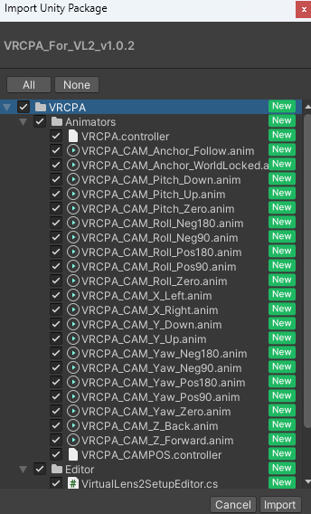
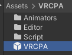
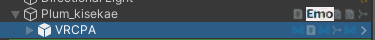
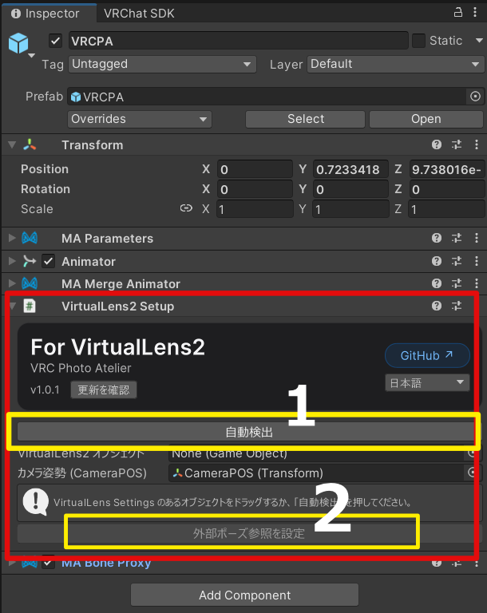
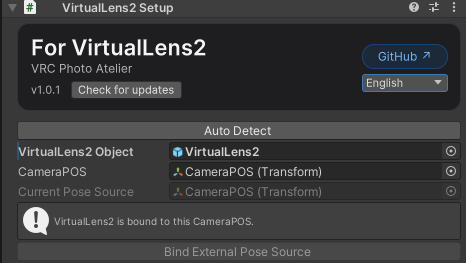
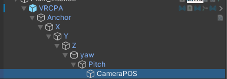
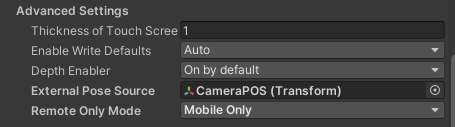

# VRCPA for Unity

[English](README.md) · [简体中文](README.zh-CN.md) · **日本語**

これは [VRC Photo Atelier](https://github.com/VRCPA/VRC-Photo-Atelier) の Unity 用サブリポジトリです。

## インストールとセットアップ

1. [Releases](https://github.com/VRCPA/VRCPA_For_Unity/releases/latest) から `.unitypackage` をダウンロードし、Unity プロジェクトにインポートします。

   

2. Project ウィンドウの `Assets/VRCPA` にある `VRCPA` プレハブを、Hierarchy でアバターのルートオブジェクトの直下に配置します（例では `Plum_kisekae` という名前のアバターを使用しています）。

   

   

3. Hierarchy で `VRCPA` を選択し、Inspector の **自動検出** をクリックします。

4. **VirtualLens2 オブジェクト** と **カメラ姿勢 (CameraPOS)** の両方に値が入ったら、**外部ポーズ参照を設定** をクリックします。Inspector に「VirtualLens2 にこの CameraPOS が設定されています。」と表示されれば、セットアップは完了です。

   

   

## 自動検出できないとき

- Hierarchy で `VRCPA` 配下の `CameraPOS` を、Inspector の **カメラ姿勢 (CameraPOS)** 欄にドラッグします。
- Hierarchy で **Virtual Lens Settings** コンポーネントが付いた VirtualLens2 オブジェクトを、Inspector の **VirtualLens2 オブジェクト** 欄にドラッグします。

両方の欄に値を入れたら、**外部ポーズ参照を設定** をクリックします。

## 設定による変更

この操作では、VirtualLens2 の **External Pose Source** の参照先だけが VRCPA の `CameraPOS` に変わります。変更前のポーズ参照先に依存する他のギミックの動作に影響する場合があります。

## パフォーマンス

VRCPA が追加する同期パラメーターは 0 個で、ローカルの float パラメーターを 7 個使用します。

## 対応

このパッケージは VirtualLens2 に対応しています。

## 依存関係

- Modular Avatar
- VirtualLens2
