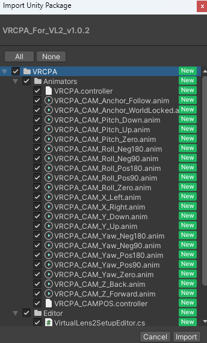
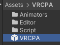

# VRCPA for Unity

**English** · [简体中文](README.zh-CN.md) · [日本語](README.ja.md)

This is the Unity subrepository for [VRC Photo Atelier](https://github.com/VRCPA/VRC-Photo-Atelier).

## Installation and setup

1. Download the `.unitypackage` from [Releases](https://github.com/VRCPA/VRCPA_For_Unity/releases/latest) and import it into your Unity project.

   

2. In the Project window, find the `VRCPA` prefab under `Assets/VRCPA` and place it as a direct child of your avatar’s root object in the Hierarchy (the example avatar is named `Plum_kisekae`).

   

   

3. Select `VRCPA` in the Hierarchy and click **Auto Detect** in the Inspector.

4. Once **VirtualLens2 Object** and **CameraPOS** are filled in, click **Bind External Pose Source**. Setup is complete when the Inspector confirms that VirtualLens2 is bound to this CameraPOS.

   

   

## If auto-detection fails

- For **CameraPOS**, drag the `CameraPOS` object under `VRCPA` from the Hierarchy into the **CameraPOS** field in the Inspector.
- For **VirtualLens2 Object**, drag the VirtualLens2 object with the **Virtual Lens Settings** component from the Hierarchy into the **VirtualLens2 Object** field.

After filling in both fields, click **Bind External Pose Source**.

## What binding changes

Binding only updates VirtualLens2’s **External Pose Source**, setting it to VRCPA’s `CameraPOS`. This can affect other avatar features that rely on the previous pose source.

## Performance

VRCPA adds 0 synced parameters and uses 7 local float parameters.

## Support

This package supports VirtualLens2.

## Dependencies

- Modular Avatar
- VirtualLens2
