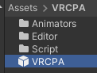
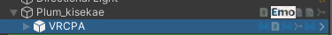
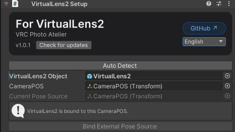
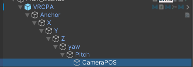
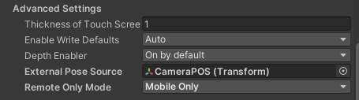

# VRCPA for Unity

[English](README.md) · **简体中文** · [日本語](README.ja.md)

这是 [VRC Photo Atelier](https://github.com/VRCPA/VRC-Photo-Atelier) 的 Unity 子仓库。

## 安装与配置

1. 从 [Releases](https://github.com/VRCPA/VRCPA_For_Unity/releases/latest) 下载 `.unitypackage`，并导入 Unity 项目。
2. 在 Project 窗口的 `Assets/VRCPA` 中找到 `VRCPA` 预制体，在 Hierarchy 中将其设为 Avatar 根对象的直接子对象。

   

   

3. 在 Hierarchy 中选中 `VRCPA`，然后在 Inspector 中点击 **自动检测**。
4. **VirtualLens2 对象**和**相机位姿 (CameraPOS)** 都填好后，点击 **绑定外部位姿来源**。Inspector 提示 VirtualLens2 已绑定到这个 CameraPOS 时，配置即完成。

   

## 自动检测失败时

- 将 Hierarchy 中 `VRCPA` 下的 `CameraPOS` 对象拖到 Inspector 的 **相机位姿 (CameraPOS)** 字段。
- 将 Hierarchy 中带有 **Virtual Lens Settings** 组件的 VirtualLens2 对象拖到 Inspector 的 **VirtualLens2 对象**字段。

两个字段都填好后，点击 **绑定外部位姿来源**。

## 绑定会修改什么

绑定只会将 VirtualLens2 的 **External Pose Source** 指向 VRCPA 的 `CameraPOS`。依赖原有位姿来源的其他 Avatar 功能可能受影响。

## 性能

VRCPA 新增 0 个同步参数，使用 7 个本地浮点参数。

## 支持

此包支持 VirtualLens2。

## 依赖

- Modular Avatar
- VirtualLens2
